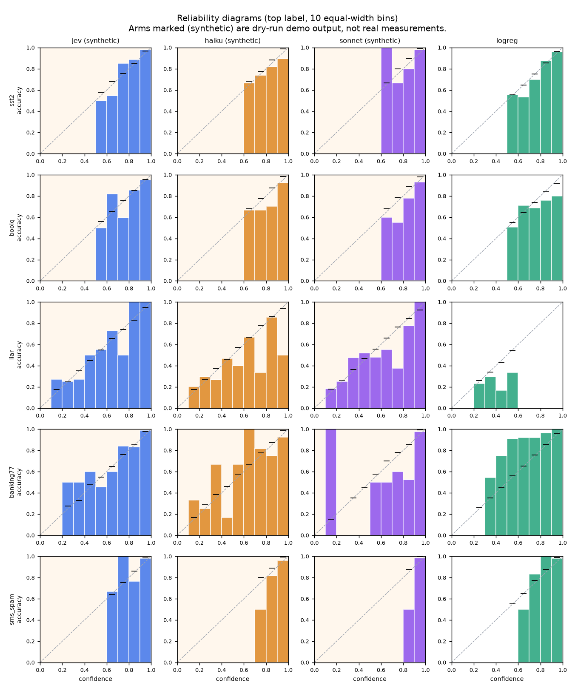
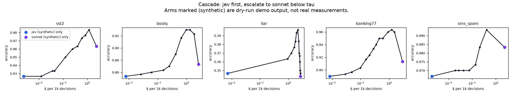
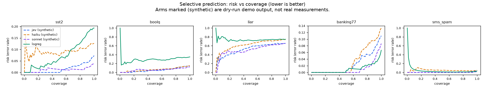
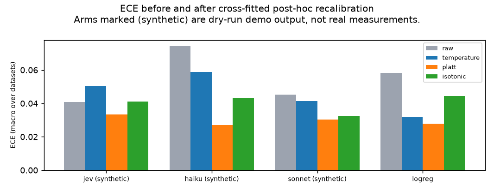
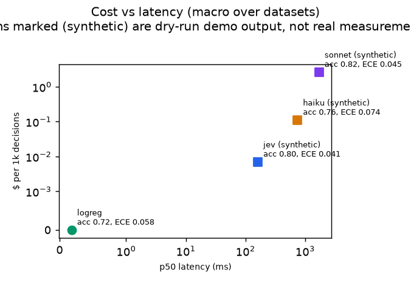

# jev-calibration-lab

[](https://github.com/veermshah/jev-calibration-lab/actions/workflows/ci.yml)
[](https://veermshah.github.io/jev-calibration-lab/)
[](LICENSE)

An independent calibration benchmark for "System One" decision models. It checks whether the
probabilities TypeSafe's Jev returns match **human** ground truth, and compares them with Claude
Haiku 5.5, Claude Sonnet 5.5 and a plain TF-IDF logistic regression on five public, human-labeled
datasets.

> **Status: the harness is complete; real Jev and Claude runs are waiting on API keys.**
> Every number for the `jev`, `haiku` and `sonnet` arms in this repo comes from `--dry-run`:
> invented generators that mimic each provider's reply format so the whole pipeline can be
> exercised end to end. Those numbers are labeled *synthetic* everywhere they appear and are not
> measurements of either model. The `logreg` baseline numbers are real.

## Why I built this

Jev launched on September 15, 2026. You send it a state and typed questions, and in roughly
70 to 500 ms it returns choices, scores or booleans, each with a probability attached. TypeSafe
trains it with what they call RLCD (Reinforcement Learning for Calibrated Decisions), so
calibration is the whole selling point: a 0.8 should be right about 80% of the time.

What bothered me is how that gets checked. TypeSafe's own benchmark labels ground truth by
averaging two frontier LLMs. That measures agreement with those LLMs, not accuracy, and it says
nothing about whether a 0.8 means 80% against what people would answer. I couldn't find an
independent check against human labels, so I wrote one.

The questions I want answered:

1. Is Jev calibrated against human labels, not just against other models?
2. How does it compare with a frontier LLM asked to state probabilities, at very different cost
   and latency?
3. Does training for calibration beat the cheap fixes anyone can apply afterwards (temperature
   scaling, Platt scaling, isotonic regression on a few hundred held-out labels)?
4. Are Jev's confidences good enough to route on: answer with Jev when it is sure, escalate to
   Sonnet when it isn't?

## Method

**Datasets.** Five public datasets where the labels come from people. `jevlab fetch` downloads
them and draws a fixed-seed sample of 300 evaluation items each (seed `20260915`), plus a disjoint
training split used only by the baseline.

| dataset | task | choices | eval source | train source |
|---|---|---:|---|---|
| SST-2 (Socher et al., 2013) | movie-review sentiment | 2 | validation | train |
| BoolQ (Clark et al., 2019) | yes/no question about a passage | 2 | validation | train |
| LIAR (Wang, 2017) | PolitiFact truthfulness rating | 6 | test | train |
| banking77 (Casanueva et al., 2020) | intent, 10 confusable card intents | 10 | test | train |
| SMS Spam Collection (Almeida et al., 2011) | ham vs spam | 2 | 300 sampled | the rest |

Each item becomes a typed decision: a `state`, a `question`, a closed set of named choices with
descriptions, and the gold label. LIAR keeps all six ratings as an ordered choice, and the
speaker's historical "credit counts" are left out because they leak the label.

**Arms.** Every arm implements one interface, `DecisionModel.predict(decision) -> Prediction`,
which returns a probability per choice plus latency, token counts and cost.

- `jev`: TypeSafe's System One API. Each decision is sent as a single `choice` question and the
  arm reads Jev's native `probabilities` object.
- `haiku`, `sonnet`: `claude-haiku-5-5` and `claude-sonnet-5-5` through the Messages API. They
  return stated probabilities for every choice through structured output (`output_config.format`
  with a JSON schema that requires one number per choice), at `effort: "low"`.
- `logreg`: TF-IDF (word 1-2 grams) and logistic regression with the regularization strength
  picked by cross-validated log loss on the training split. Free, local and fast, which makes it
  a useful floor.
- Any other model: add a section to [`configs/arms.toml`](configs/arms.toml). See
  [Adding a model](#adding-a-model).

**Metrics.** All calibration metrics use the top label (confidence = highest probability).

- Accuracy.
- ECE with 15 equal-width bins (Naeini et al., 2015; Guo et al., 2017) and adaptive ECE with
  equal-mass bins (Nixon et al., 2019).
- Brier score, multi-class form (Brier, 1950), and negative log-likelihood.
- Reliability diagrams.
- Selective prediction: risk-coverage curves, AURC and accuracy at 80% coverage (Geifman and
  El-Yaniv, 2017).
- p50 and p95 latency, and dollars per 1,000 decisions from the editable cost model in
  [`configs/pricing.toml`](configs/pricing.toml).
- Run-to-run variance: the first 50 items of each dataset are sent 5 times. I report the spread
  of accuracy and ECE, the mean per-item spread of the gold-class probability, and the flip rate
  (share of items whose top answer changes in any repeat).
- 95% percentile-bootstrap confidence intervals (1,000 resamples) on every per-dataset metric,
  plus paired comparisons between every pair of arms on the same items: paired bootstrap for the
  accuracy, Brier and ECE differences, and an exact McNemar test on correctness.

**Post-hoc recalibration.** Temperature scaling (Guo et al., 2017), Platt scaling (Platt, 1999)
and isotonic regression (Zadrozny and Elkan, 2002) are applied to every arm with 2-fold
cross-fitting on the evaluation sample, so no item is scored by a map that saw its own label.
Platt and isotonic act on the top-label confidence and rescale the other choices without
changing the argmax. If a two-parameter fix brings an LLM to Jev's calibration, then native
calibration is worth less than it sounds.

**Cascade.** Jev answers first. If its top probability is below a threshold tau, the item goes to
Sonnet. Sweeping tau from 0 (never escalate) to 1 (always escalate) traces a cost vs accuracy
curve. The cascade is sequential, so an escalated item pays for both calls and waits for both.
Any pair of arms works: `jevlab report --cascade haiku:sonnet`.

**Running it safely.** Responses are cached on disk under a hash of (model, request, repeat), so a
rerun costs nothing. `--budget-usd` (default 15) is a hard cap: before every paid call the runner
reserves a pessimistic cost estimate and refuses the call if spend plus outstanding reservations
would cross the cap, so parallel workers can't overshoot it together. Concurrency is bounded per
arm, and transient failures (429, 5xx, timeouts) are retried with exponential backoff and jitter.

## Results so far

The full report, with per-dataset tables and confidence intervals, is in
[`report/report.md`](report/report.md). The interactive version is the
[leaderboard](https://veermshah.github.io/jev-calibration-lab/). Its "All datasets" view
macro-averages the table metrics and the risk-coverage and cascade curves (each dataset weighted
equally) and pools the reliability bins over every item from every dataset.

**Real numbers: the TF-IDF baseline** (300 items per dataset, 95% bootstrap CI on accuracy):

| dataset | accuracy | ECE | adaptive ECE | Brier | NLL | AURC |
|---|---|---:|---:|---:|---:|---:|
| SST-2 | 0.807 [0.767, 0.850] | 0.032 | 0.055 | 0.264 | 0.408 | 0.073 |
| BoolQ | 0.650 [0.600, 0.703] | 0.071 | 0.118 | 0.445 | 0.639 | 0.288 |
| LIAR (6-way) | 0.253 [0.203, 0.303] | 0.052 | 0.088 | 0.808 | 1.684 | 0.732 |
| banking77 (10 intents) | 0.933 [0.903, 0.957] | 0.119 | 0.110 | 0.127 | 0.311 | 0.010 |
| SMS Spam | 0.967 [0.947, 0.987] | 0.018 | 0.022 | 0.048 | 0.181 | 0.041 |

Two things already stand out. Logistic regression is well calibrated on most tasks even when it is
not very accurate (LIAR), which is a reminder that low ECE alone is a weak claim. And on banking77
it is *under*confident: temperature scaling cuts its ECE from 0.119 to 0.038. Any model claiming
good calibration should at least beat what a few hundred labels and one fitted parameter give you.

**Synthetic demo numbers for the other arms** are in the report and figures below so you can see
what the output looks like. They come from hand-set generator profiles in
[`src/jevlab/arms/synthetic.py`](src/jevlab/arms/synthetic.py), not from any API.

### Figures (Jev and Claude panels are synthetic)

| | |
|---|---|
|  |  |
| Reliability diagrams per arm and dataset | Cascade: cost per 1k decisions vs accuracy |
|  |  |
| Selective prediction (risk vs coverage) | ECE before and after post-hoc recalibration |
|  | |
| Cost vs latency, macro average | |

## How to run

Requires Python 3.11+.

```bash
python3.12 -m venv .venv && source .venv/bin/activate
pip install -e ".[dev]"

jevlab fetch                                  # download datasets, write fixed-seed samples
jevlab run --dry-run                          # synthetic API arms + real baseline, no keys needed
jevlab report                                 # report/report.md, report/figures/, report/summary.json
jevlab site                                   # site/index.html leaderboard
pytest -q                                     # tests, no network
```

### Reproducing with real API keys (3 commands)

Copy `.env.example` to `.env` and fill in `TYPESAFE_API_KEY` and `ANTHROPIC_API_KEY`, then:

```bash
jevlab fetch
jevlab run --arms jev,haiku,sonnet,logreg --budget-usd 15
jevlab report && jevlab site
```

A dry run prints the projected cost of the same calls made for real, so you can check the budget
first. With the default settings (5 datasets x 300 items, 5 repeats on 50 items) it projects about
$6.80, almost all of it Sonnet. Useful flags: `--limit 20` for a smoke test, `--datasets sst2,liar`,
`--repeats 1`, `--no-cache`, `--run-name` to keep several runs side by side.

### Adding a model

Arms are configured, not coded. To benchmark anything that speaks the OpenAI-style
`/chat/completions` API with JSON-schema output (vLLM, llama.cpp server, Ollama, most gateways),
add a section to `configs/arms.toml` and a price to `configs/pricing.toml`:

```toml
# configs/arms.toml
[arms.local]
type = "openai_compatible"
model = "my-local-model"
base_url = "http://localhost:8000/v1"
api_key_env = "MY_ENDPOINT_API_KEY"   # optional
max_tokens = 512
concurrency = 2

# configs/pricing.toml
[models."my-local-model"]
input_per_mtok = 0.0
output_per_mtok = 0.0
```

Then `jevlab run --arms jev,local`. A new provider with a different wire format needs a small
subclass of `RemoteDecisionModel` with `build_request` and `parse_response`; caching, budget,
retries and metrics come for free.

## The Jev adapter

The request and response shapes come from TypeSafe's public API reference
([docs.typesafe.ai/api](https://docs.typesafe.ai/api)):

```http
POST https://api.typesafe.ai/v1/systemone
Authorization: Bearer $TYPESAFE_API_KEY

{"model": "jev-latest",
 "state": "<item text>",
 "questions": {"answer": {"type": "choice",
                          "instructions": "<question>",
                          "criteria": {"<choice id>": "<description>", ...}}}}
```

The arm reads `answers.answer.probabilities` (one probability per choice name) and
`usage.input_tokens` / `usage.output_tokens`. If a response only carries `choice` and
`confidence`, the remaining mass is spread evenly over the other choices and that is noted in the
code. Binary tasks are sent as two-way `choice` questions rather than `noul` so that every dataset
goes through the same path. The price in `configs/pricing.toml` ($0.042 per million input tokens,
output free) is the rate listed by the community `typesafe-jev` clients; TypeSafe's reference says
input is billable and output is currently free, so check the rate on your account. The adapter
has been tested against recorded responses in the documented shape, not against the live API yet.

## Limitations

- **No real Jev or Claude numbers yet.** The harness, caching, budget cap, parsing and reporting
  are tested, but the comparison this project exists for still needs a run with keys.
- 300 items per dataset gives accuracy CIs of roughly plus or minus 4 to 5 points. ECE estimates on
  samples this size are biased upward and noisy, which is why the report shows adaptive ECE,
  Brier, NLL and bootstrap intervals alongside it.
- Human labels are not perfect either. SST-2 and LIAR in particular have known annotation noise,
  and LIAR's six-way ratings are subjective. Calibration "against humans" here means against
  these particular annotators.
- Stated probabilities from an LLM depend on the prompt and the output format. I use one prompt and
  one schema for both Claude models; other prompting (verbalized confidence, sampling-based
  estimates) could calibrate differently.
- Recalibration is fitted on half the evaluation sample at a time, which is realistic for a team
  with a few hundred labels but small for isotonic regression.
- Latency is measured from my machine and includes network time; the cascade assumes sequential
  calls.
- These are public datasets, so some test items may have been seen in training by any of the
  models.

## References

- Almeida, Hidalgo and Yamakami (2011). Contributions to the study of SMS spam filtering. DocEng.
- Brier (1950). Verification of forecasts expressed in terms of probability. Monthly Weather Review.
- Casanueva et al. (2020). Efficient intent detection with dual sentence encoders. NLP4ConvAI.
- Clark et al. (2019). BoolQ: Exploring the surprising difficulty of natural yes/no questions. NAACL.
- Geifman and El-Yaniv (2017). Selective classification for deep neural networks. NeurIPS.
- Guo, Pleiss, Sun and Weinberger (2017). On calibration of modern neural networks. ICML.
- Naeini, Cooper and Hauskrecht (2015). Obtaining well calibrated probabilities using Bayesian binning. AAAI.
- Nixon et al. (2019). Measuring calibration in deep learning. CVPR Workshops.
- Platt (1999). Probabilistic outputs for support vector machines.
- Socher et al. (2013). Recursive deep models for semantic compositionality over a sentiment treebank. EMNLP.
- Tian et al. (2023). Just ask for calibration: strategies for eliciting calibrated confidence scores from language models. EMNLP.
- Wang (2017). "Liar, liar pants on fire": A new benchmark dataset for fake news detection. ACL.
- Zadrozny and Elkan (2002). Transforming classifier scores into accurate multiclass probability estimates. KDD.

## Citing

If this is useful to you, see [`CITATION.cff`](CITATION.cff).

## License

MIT, see [LICENSE](LICENSE). The datasets keep their own licenses and are downloaded from their
original sources, not redistributed here.
