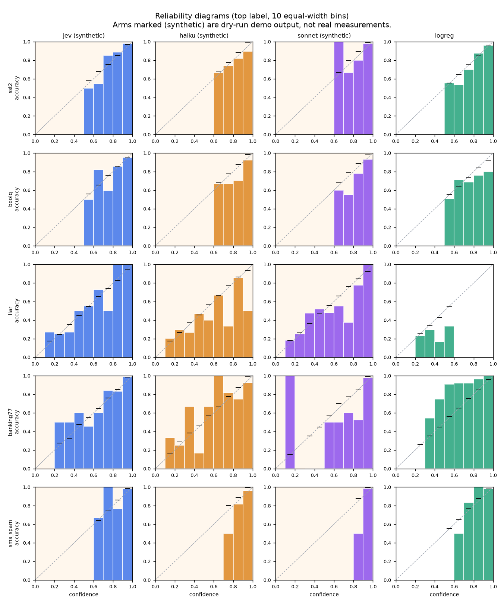
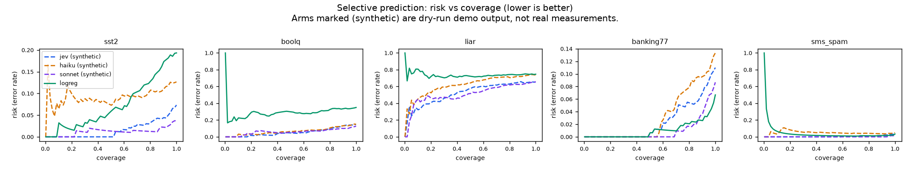
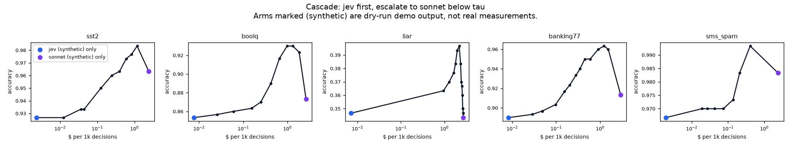
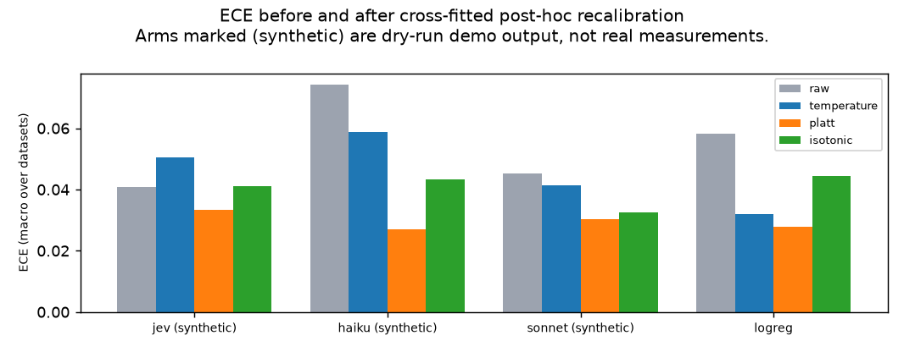
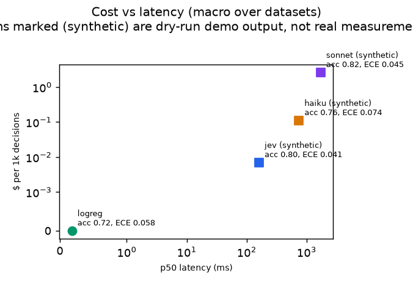

# jev-calibration-lab report

Generated 2026-11-01.

> **Synthetic demo output.** Arms marked *synthetic* were produced by `--dry-run`: invented generators that mimic each provider's reply format. They are **not** measurements of TypeSafe Jev or Claude and say nothing about how those models behave. Only arms without the marker are real measurements.

- Real measurements: logreg
- Synthetic (dry-run) arms: jev, haiku, sonnet

Run: 10000 predictions, 5 repeats on a 50-item subset, budget cap $15.00, $6.7978 (projected cost of the same calls made for real).

## Datasets

| dataset | items | choices |
|---|---:|---:|
| SST-2 sentiment (validation) | 300 | 2 |
| BoolQ yes/no QA (validation) | 300 | 2 |
| LIAR six-way fact-check (test) | 300 | 6 |
| banking77, 10 card intents (test) | 300 | 10 |
| SMS Spam Collection | 300 | 2 |

## Headline (macro average over datasets)

| arm | accuracy | ECE | adaptive ECE | Brier | NLL | AURC | acc@80% cov | p50 ms | p95 ms | $/1k |
|---|---:|---:|---:|---:|---:|---:|---:|---:|---:|---:|
| haiku (synthetic) | 0.761 | 0.074 | 0.073 | 0.309 | 0.676 | 0.172 | 0.792 | 745.1 | 1217.3 | 0.1102 |
| jev (synthetic) | 0.797 | 0.041 | 0.048 | 0.247 | 0.462 | 0.124 | 0.835 | 161.2 | 285.7 | 0.0069 |
| logreg | 0.722 | 0.058 | 0.078 | 0.338 | 0.645 | 0.229 | 0.755 | 0.2 | 0.2 | 0.0000 |
| sonnet (synthetic) | 0.815 | 0.045 | 0.049 | 0.224 | 0.435 | 0.118 | 0.853 | 1714.2 | 2762.4 | 2.6043 |

## Per dataset (95% bootstrap CIs)

### SST-2 sentiment (validation)

| arm | accuracy | ECE (15 bins) | Brier | NLL | AURC | p50 ms | $/1k | errors |
|---|---|---|---|---|---|---:|---:|---:|
| haiku (synthetic) | 0.873 [0.837, 0.910] | 0.091 [0.064, 0.132] | 0.232 [0.167, 0.297] | 0.600 [0.421, 0.804] | 0.095 [0.058, 0.151] | 719.9 | 0.1005 | 0 |
| jev (synthetic) | 0.927 [0.897, 0.953] | 0.037 [0.023, 0.068] | 0.118 [0.085, 0.157] | 0.206 [0.162, 0.261] | 0.016 [0.008, 0.027] | 157.5 | 0.0043 | 0 |
| logreg | 0.807 [0.767, 0.850] | 0.032 [0.028, 0.086] | 0.264 [0.216, 0.309] | 0.408 [0.339, 0.477] | 0.073 [0.046, 0.104] | 0.2 | 0.0000 | 0 |
| sonnet (synthetic) | 0.963 [0.940, 0.983] | 0.027 [0.011, 0.050] | 0.068 [0.034, 0.109] | 0.153 [0.075, 0.254] | 0.012 [0.003, 0.037] | 1701.6 | 2.4103 | 0 |

### BoolQ yes/no QA (validation)

| arm | accuracy | ECE (15 bins) | Brier | NLL | AURC | p50 ms | $/1k | errors |
|---|---|---|---|---|---|---:|---:|---:|
| haiku (synthetic) | 0.850 [0.810, 0.890] | 0.092 [0.058, 0.133] | 0.248 [0.186, 0.311] | 0.488 [0.354, 0.631] | 0.066 [0.044, 0.121] | 760.8 | 0.1110 | 0 |
| jev (synthetic) | 0.853 [0.813, 0.893] | 0.049 [0.035, 0.096] | 0.224 [0.175, 0.273] | 0.357 [0.288, 0.423] | 0.054 [0.032, 0.078] | 162.0 | 0.0089 | 0 |
| logreg | 0.650 [0.600, 0.703] | 0.071 [0.044, 0.134] | 0.445 [0.405, 0.485] | 0.639 [0.593, 0.684] | 0.288 [0.221, 0.354] | 0.2 | 0.0000 | 0 |
| sonnet (synthetic) | 0.873 [0.837, 0.910] | 0.079 [0.050, 0.116] | 0.211 [0.154, 0.272] | 0.414 [0.296, 0.552] | 0.060 [0.032, 0.100] | 1712.3 | 2.6201 | 0 |

### LIAR six-way fact-check (test)

| arm | accuracy | ECE (15 bins) | Brier | NLL | AURC | p50 ms | $/1k | errors |
|---|---|---|---|---|---|---:|---:|---:|
| haiku (synthetic) | 0.263 [0.210, 0.313] | 0.061 [0.047, 0.119] | 0.765 [0.740, 0.787] | 1.572 [1.520, 1.618] | 0.619 [0.538, 0.698] | 767.2 | 0.1153 | 0 |
| jev (synthetic) | 0.347 [0.293, 0.403] | 0.071 [0.053, 0.136] | 0.674 [0.650, 0.697] | 1.331 [1.281, 1.377] | 0.520 [0.441, 0.603] | 158.3 | 0.0087 | 0 |
| logreg | 0.253 [0.203, 0.303] | 0.052 [0.032, 0.107] | 0.808 [0.790, 0.827] | 1.684 [1.636, 1.733] | 0.732 [0.658, 0.802] | 0.2 | 0.0000 | 0 |
| sonnet (synthetic) | 0.343 [0.290, 0.397] | 0.056 [0.053, 0.124] | 0.682 [0.651, 0.713] | 1.313 [1.262, 1.366] | 0.508 [0.434, 0.589] | 1744.3 | 2.7056 | 0 |

### banking77, 10 card intents (test)

| arm | accuracy | ECE (15 bins) | Brier | NLL | AURC | p50 ms | $/1k | errors |
|---|---|---|---|---|---|---:|---:|---:|
| haiku (synthetic) | 0.867 [0.830, 0.907] | 0.089 [0.064, 0.132] | 0.207 [0.149, 0.268] | 0.446 [0.322, 0.579] | 0.032 [0.019, 0.047] | 746.3 | 0.1260 | 0 |
| jev (synthetic) | 0.890 [0.853, 0.927] | 0.030 [0.031, 0.075] | 0.158 [0.113, 0.206] | 0.304 [0.236, 0.379] | 0.024 [0.013, 0.037] | 163.2 | 0.0092 | 0 |
| logreg | 0.933 [0.903, 0.957] | 0.119 [0.096, 0.146] | 0.127 [0.099, 0.159] | 0.311 [0.258, 0.373] | 0.010 [0.004, 0.020] | 0.2 | 0.0000 | 0 |
| sonnet (synthetic) | 0.913 [0.880, 0.943] | 0.052 [0.030, 0.082] | 0.129 [0.086, 0.178] | 0.248 [0.164, 0.351] | 0.010 [0.005, 0.017] | 1707.1 | 2.9202 | 0 |

### SMS Spam Collection

| arm | accuracy | ECE (15 bins) | Brier | NLL | AURC | p50 ms | $/1k | errors |
|---|---|---|---|---|---|---:|---:|---:|
| haiku (synthetic) | 0.950 [0.927, 0.977] | 0.038 [0.017, 0.062] | 0.093 [0.045, 0.137] | 0.275 [0.125, 0.415] | 0.050 [0.012, 0.071] | 731.2 | 0.0983 | 0 |
| jev (synthetic) | 0.967 [0.947, 0.987] | 0.017 [0.010, 0.040] | 0.060 [0.029, 0.095] | 0.113 [0.061, 0.172] | 0.005 [0.001, 0.010] | 164.8 | 0.0035 | 0 |
| logreg | 0.967 [0.947, 0.987] | 0.018 [0.010, 0.037] | 0.048 [0.021, 0.080] | 0.181 [0.050, 0.358] | 0.041 [0.001, 0.086] | 0.2 | 0.0000 | 0 |
| sonnet (synthetic) | 0.983 [0.967, 0.993] | 0.013 [0.003, 0.028] | 0.029 [0.010, 0.057] | 0.050 [0.017, 0.094] | 0.001 [0.000, 0.001] | 1705.6 | 2.3655 | 0 |

## Post-hoc recalibration

ECE before and after each method, 2-fold cross-fitted on the evaluation sample (macro over datasets). If a cheap fix closes most of the gap, native calibration matters less than it sounds.

| arm | raw ECE | temperature | Platt | isotonic | best NLL after |
|---|---:|---:|---:|---:|---:|
| jev (synthetic) | 0.041 | 0.051 | 0.033 | 0.041 | 0.440 |
| haiku (synthetic) | 0.074 | 0.059 | 0.027 | 0.043 | 0.576 |
| sonnet (synthetic) | 0.045 | 0.041 | 0.030 | 0.033 | 0.409 |
| logreg | 0.058 | 0.032 | 0.028 | 0.044 | 0.633 |

## Run-to-run variance

Same items sent repeatedly. Flip rate is the share of items whose top answer changes in any repeat.

| arm | dataset | items | repeats | accuracy mean | accuracy std | ECE std | gold-prob std | flip rate |
|---|---|---:|---:|---:|---:|---:|---:|---:|
| haiku (synthetic) | banking77 | 50 | 5 | 0.940 | 0.014 | 0.017 | 0.025 | 0.040 |
| haiku (synthetic) | boolq | 50 | 5 | 0.856 | 0.017 | 0.013 | 0.050 | 0.060 |
| haiku (synthetic) | liar | 50 | 5 | 0.224 | 0.036 | 0.051 | 0.029 | 0.300 |
| haiku (synthetic) | sms_spam | 50 | 5 | 0.928 | 0.011 | 0.010 | 0.029 | 0.060 |
| haiku (synthetic) | sst2 | 50 | 5 | 0.820 | 0.020 | 0.029 | 0.071 | 0.120 |
| jev (synthetic) | banking77 | 50 | 5 | 0.900 | 0.000 | 0.000 | 0.003 | 0.000 |
| jev (synthetic) | boolq | 50 | 5 | 0.720 | 0.000 | 0.017 | 0.003 | 0.000 |
| jev (synthetic) | liar | 50 | 5 | 0.340 | 0.000 | 0.019 | 0.008 | 0.000 |
| jev (synthetic) | sms_spam | 50 | 5 | 0.960 | 0.000 | 0.000 | 0.001 | 0.000 |
| jev (synthetic) | sst2 | 50 | 5 | 0.940 | 0.000 | 0.005 | 0.002 | 0.000 |
| logreg | banking77 | 50 | 5 | 0.960 | 0.000 | 0.000 | 0.000 | 0.000 |
| logreg | boolq | 50 | 5 | 0.600 | 0.000 | 0.000 | 0.000 | 0.000 |
| logreg | liar | 50 | 5 | 0.300 | 0.000 | 0.000 | 0.000 | 0.000 |
| logreg | sms_spam | 50 | 5 | 1.000 | 0.000 | 0.000 | 0.000 | 0.000 |
| logreg | sst2 | 50 | 5 | 0.860 | 0.000 | 0.000 | 0.000 | 0.000 |
| sonnet (synthetic) | banking77 | 50 | 5 | 0.956 | 0.009 | 0.007 | 0.011 | 0.020 |
| sonnet (synthetic) | boolq | 50 | 5 | 0.900 | 0.014 | 0.017 | 0.021 | 0.040 |
| sonnet (synthetic) | liar | 50 | 5 | 0.368 | 0.018 | 0.033 | 0.042 | 0.120 |
| sonnet (synthetic) | sms_spam | 50 | 5 | 1.000 | 0.000 | 0.000 | 0.000 | 0.000 |
| sonnet (synthetic) | sst2 | 50 | 5 | 0.976 | 0.009 | 0.009 | 0.010 | 0.020 |

## Cascade

First arm answers; items whose top probability is below tau are escalated. Each row is the cheapest tau whose accuracy is within one point of always escalating.

| dataset | cascade | first-only acc | always-escalate acc | chosen tau | escalated | acc | $/1k | cost vs always-escalate |
|---|---|---:|---:|---:|---:|---:|---:|---:|
| sst2 | jev -> sonnet (synthetic) | 0.927 | 0.963 | 0.75 | 0.10 | 0.960 | 0.2449 | 10.1% |
| boolq | jev -> sonnet (synthetic) | 0.853 | 0.873 | 0.65 | 0.06 | 0.863 | 0.1550 | 5.9% |
| liar | jev -> sonnet (synthetic) | 0.347 | 0.343 | 0.00 | 0.00 | 0.347 | 0.0087 | 0.3% |
| banking77 | jev -> sonnet (synthetic) | 0.890 | 0.913 | 0.50 | 0.03 | 0.903 | 0.0968 | 3.3% |
| sms_spam | jev -> sonnet (synthetic) | 0.967 | 0.983 | 0.85 | 0.06 | 0.973 | 0.1374 | 5.8% |

## Paired comparisons

Differences are a minus b on the same items; CIs and p-values from a paired bootstrap, plus an exact McNemar test on correctness.

| dataset | a vs b | accuracy diff [95% CI] | Brier diff [95% CI] | McNemar p |
|---|---|---|---|---:|
| sst2 | haiku vs jev (synthetic) | -0.053 [-0.107, -0.003] | +0.113 [+0.037, +0.192] | 0.0479 |
| sst2 | haiku vs logreg (synthetic) | +0.067 [+0.013, +0.120] | -0.032 [-0.111, +0.041] | 0.0265 |
| sst2 | haiku vs sonnet (synthetic) | -0.090 [-0.133, -0.047] | +0.163 [+0.091, +0.236] | 0.0001 |
| sst2 | jev vs logreg (synthetic) | +0.120 [+0.067, +0.170] | -0.145 [-0.202, -0.086] | 0.0000 |
| sst2 | jev vs sonnet (synthetic) | -0.037 [-0.073, +0.000] | +0.050 [-0.006, +0.105] | 0.0801 |
| sst2 | logreg vs sonnet (synthetic) | -0.157 [-0.203, -0.103] | +0.195 [+0.127, +0.254] | 0.0000 |
| boolq | haiku vs jev (synthetic) | -0.003 [-0.060, +0.053] | +0.024 [-0.054, +0.103] | 1.0000 |
| boolq | haiku vs logreg (synthetic) | +0.200 [+0.133, +0.273] | -0.197 [-0.274, -0.122] | 0.0000 |
| boolq | haiku vs sonnet (synthetic) | -0.023 [-0.077, +0.033] | +0.037 [-0.052, +0.125] | 0.4887 |
| boolq | jev vs logreg (synthetic) | +0.203 [+0.137, +0.267] | -0.221 [-0.287, -0.156] | 0.0000 |
| boolq | jev vs sonnet (synthetic) | -0.020 [-0.080, +0.040] | +0.013 [-0.073, +0.097] | 0.5764 |
| boolq | logreg vs sonnet (synthetic) | -0.223 [-0.290, -0.157] | +0.234 [+0.161, +0.310] | 0.0000 |
| liar | haiku vs jev (synthetic) | -0.083 [-0.160, -0.010] | +0.090 [+0.055, +0.124] | 0.0474 |
| liar | haiku vs logreg (synthetic) | +0.010 [-0.060, +0.077] | -0.043 [-0.074, -0.014] | 0.8496 |
| liar | haiku vs sonnet (synthetic) | -0.080 [-0.157, -0.003] | +0.083 [+0.042, +0.120] | 0.0465 |
| liar | jev vs logreg (synthetic) | +0.093 [+0.020, +0.173] | -0.134 [-0.165, -0.103] | 0.0212 |
| liar | jev vs sonnet (synthetic) | +0.003 [-0.070, +0.087] | -0.008 [-0.046, +0.029] | 1.0000 |
| liar | logreg vs sonnet (synthetic) | -0.090 [-0.160, -0.020] | +0.126 [+0.088, +0.164] | 0.0177 |
| banking77 | haiku vs jev (synthetic) | -0.023 [-0.073, +0.033] | +0.049 [-0.031, +0.120] | 0.4500 |
| banking77 | haiku vs logreg (synthetic) | -0.067 [-0.117, -0.013] | +0.080 [+0.009, +0.149] | 0.0105 |
| banking77 | haiku vs sonnet (synthetic) | -0.047 [-0.093, +0.003] | +0.078 [+0.006, +0.149] | 0.0814 |
| banking77 | jev vs logreg (synthetic) | -0.043 [-0.090, +0.000] | +0.031 [-0.023, +0.090] | 0.0854 |
| banking77 | jev vs sonnet (synthetic) | -0.023 [-0.070, +0.027] | +0.029 [-0.032, +0.095] | 0.4101 |
| banking77 | logreg vs sonnet (synthetic) | +0.020 [-0.027, +0.063] | -0.002 [-0.060, +0.060] | 0.4614 |
| sms_spam | haiku vs jev (synthetic) | -0.017 [-0.047, +0.017] | +0.033 [-0.028, +0.088] | 0.4244 |
| sms_spam | haiku vs logreg (synthetic) | -0.017 [-0.047, +0.017] | +0.045 [-0.014, +0.097] | 0.4244 |
| sms_spam | haiku vs sonnet (synthetic) | -0.033 [-0.060, -0.007] | +0.064 [+0.014, +0.112] | 0.0309 |
| sms_spam | jev vs logreg (synthetic) | +0.000 [-0.027, +0.027] | +0.012 [-0.035, +0.054] | 1.0000 |
| sms_spam | jev vs sonnet (synthetic) | -0.017 [-0.043, +0.010] | +0.030 [-0.012, +0.074] | 0.3018 |
| sms_spam | logreg vs sonnet (synthetic) | -0.017 [-0.040, +0.007] | +0.019 [-0.017, +0.058] | 0.2668 |

## Figures

